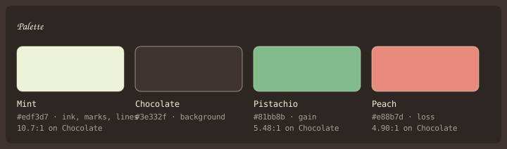
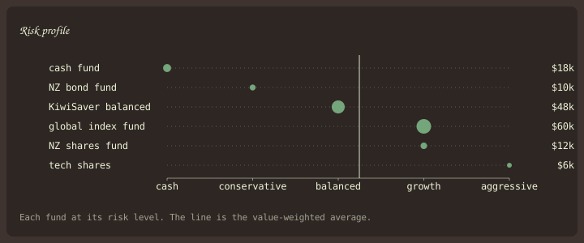
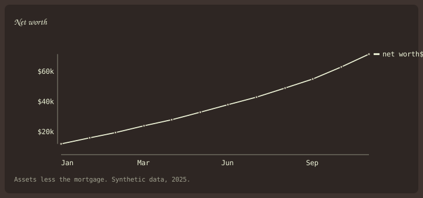
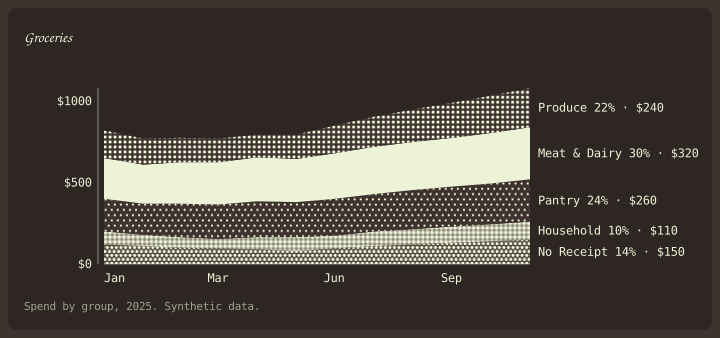
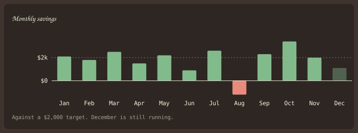
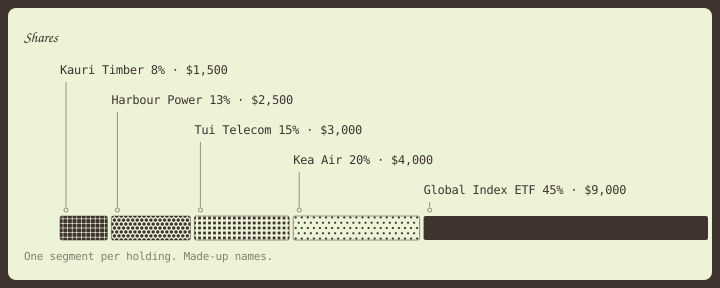
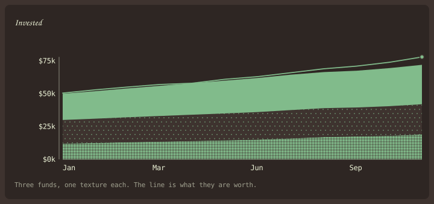
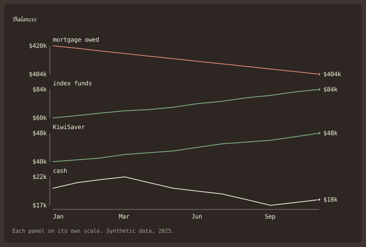

# Sediment

Sediment is a chart library for web apps. It is one JavaScript file with no
dependencies and no build step. You copy it into your app, pass it numbers
and colours, and it draws an SVG chart in an element you choose.

Its real offer is a small charting language: a set of rules for drawing
charts that read cleanly, in print or on screen, with or without colour.
Take the code, or just take the rules.


*Synthetic data in NZD. Two cards from a personal finance dashboard. The
first sits on chocolate, the second flips to mint.*

## The design language

These are the rules every Sediment chart follows. They work without the
library too.

- **Texture before colour.** Bands and segments are told apart by a pattern
  of marks, squares on a grid or dots on a hex grid. Mark spacing follows the
  value, so small parts are dense and the largest part is solid. A chart reads
  in greyscale, on a photocopier and for readers who do not see colour the
  usual way.
- **Colour means something.** Ink draws the data. Colour is kept for meaning:
  a gain, a loss, a plan against what happened. In the suggested palette that
  is Pistachio for up and Peach for down. Nothing is coloured for decoration.
- **Labels on the data, not in a legend.** Each line and band is named at its
  right end, with its latest value. Nobody has to match a swatch to a key.
- **Range frames.** With `rangeFrame` the y axis is drawn only as far as the
  data goes, so the axis itself shows the range. Otherwise a dotted hairline
  grid sits behind the data.
- **Reference lines and events.** A goal, a target or a limit is a dashed line
  with its name. A moment, such as "now", is a dotted vertical mark.
- **Honest gaps.** A missing value leaves a gap. It is never drawn as zero.
- **Cards that flip.** Labels take the text colour of the element a chart
  sits in, and you pass the ink for its marks. Swap the two and a chart moves
  from a dark card to a light one. The hero above uses both.

### Type

Sediment ships no fonts and no colours. The charts here use two free fonts
from Google Fonts: Fragment Mono for numbers and labels, so digits line up,
and Rock Salt, a handwritten face, for card titles. Labels inherit your page's
font, so any font works.

### Suggested palette



| Colour | Hex | Role | Contrast on Chocolate |
| --- | --- | --- | --- |
| Mint | `#edf3d7` | ink, marks, lines | 10.7:1 |
| Chocolate | `#3e332f` | background | |
| Pistachio | `#81bb8b` | gain | 5.48:1 |
| Peach | `#e88b7d` | loss | 4.90:1 |

Hairlines are Mint at 50% opacity, a tint rather than a fifth colour. On a
mint card the roles swap: Chocolate is the ink and Mint the background.
Contrast is measured with the WCAG 2 formula.

## A minimal example

```html
<link rel="stylesheet" href="sediment.css">
<script src="sediment.js"></script>

<div id="chart" style="color: #edf3d7; background: #3e332f"></div>

<script>
  const host = document.getElementById("chart");
  const months = ["Jan", "Feb", "Mar", "Apr", "May", "Jun",
                  "Jul", "Aug", "Sep", "Oct", "Nov", "Dec"];
  const xs = Array.from({ length: 13 }, (_, i) => Date.UTC(2026, i, 1));
  const month = t => months[new Date(t).getUTCMonth()];
  const saved = [24000, 25500, 27000, 28000, 29500, null, 33000];
  const plan = [33000, 37000, 41000, 45000, 49000, 53000, 57000];
  const nzd = v => "$" + Math.round(v).toLocaleString("en-NZ");
  const nzdK = v => "$" + Math.round(v / 1000) + "k";

  Sediment.lineChart({
    host, padR: 120, rangeFrame: true,
    title: "House deposit, saved and planned",
    xs,
    series: [
      { values: saved.concat(Array(6).fill(null)), color: "#edf3d7" },
      { values: Array(6).fill(null).concat(plan), color: "#81bb8b", dash: "6 4" },
    ],
    tokens: { axis: "#edf3d7", hair: "rgba(237,243,215,0.5)", page: "#3e332f" },
    fmtK: nzdK, fmtValue: nzd,
    xLabel: month,
    fmtX: t => month(t) + " " + new Date(t).getUTCFullYear(),
    endLabel: i => ["saved", "plan"][i],
    endValue: i => i ? nzdK(plan[6]) : "",
    refs: [{ value: 55000, label: "goal" }],
    events: [{ t: xs[6], label: "now" }],
  });
</script>
```


The June value is `null`, so the saved line breaks there. The plan is dashed
as well as coloured, so the two lines differ in shape. Each is named at its
right end. `title`, `fmtValue` and `fmtX` feed the description Sediment
writes for screen readers (see Accessibility).

## Install

There is no npm package. Copy `sediment.js` and `sediment.css` into your app
and load them as in the example. `sediment.js` adds one global,
`window.Sediment`. Of `sediment.css`, only the `svg text` rule is required.
Without it, labels render black at the wrong size. The other rules draw the
keyboard focus ring, style the optional data table, and handle forced colours
and reduced motion.

To pull updates, add the repo as a git submodule:

```bash
git submodule add https://github.com/jtrotsky/sediment.git vendor/sediment
git submodule update --remote vendor/sediment   # later, to update
```

Open `demo.html` in a browser to see every builder draw from live code.

## How it fits into your app

Every builder takes resolved values: CSS colour strings, plain numbers, and
formatter callbacks for text. Sediment never reads your theme, global state or
any DOM beyond the host you give it. You write a thin adapter that resolves
your theme (for example with `getComputedStyle`) and calls the builders.

Each builder measures the host's width (at least 320 px), clears the host and
appends a fresh `<svg>`. To redraw, call it again.

## Which chart

Pick by the question, not the shape of the data.

| Question | Builder |
| --- | --- |
| What changed? | `lineChart` |
| How has each one moved, when they differ in scale? | `smallMultiples` |
| What is it made of, and how has that changed? | `stackedArea` |
| What is it made of, now? | `segmentedBar` |
| Which is biggest, or how did each month do? | `columnChart` |
| Where does each one sit on a scale? | `dotPlot` |
| How far apart are two measures? | `barLineChart` |

Under about twenty numbers, a table usually beats any of them.

## The charts

Each is a card from the same personal finance dashboard, with synthetic data
in NZD. The company names are made up.

### dotPlot
Items on a shared ordinal axis. Position carries the meaning, dot area the
amount, and a solid line marks the average. Here each fund sits at its risk
level, and the line is the average risk, weighted by value.



### lineChart
Lines over time, each named at its end. Opt in to a range frame
(`rangeFrame`), latest values (`endValue`), reference lines (`refs`) and
events (`events`). Here net worth is one line, named by its latest value.



### stackedArea
Stacked bands over time, each a texture, each labelled on the right with its
share and latest value. Here grocery spend splits into five groups. Texture
density follows each group's latest value, so only the largest is solid.



### columnChart
Columns on a shared baseline, positive and negative, with an optional target
line. Here each month's savings meet a $2,000 target. Months that lost money
drop below the line in Peach, and the month still running is faint.



### segmentedBar
Proportional segments, texture-coded, with optional stepped labels. Here each
segment is one holding in a share portfolio, on a mint card.



### barLineChart
A textured area for one measure with a line over it for another, so the gap
between them reads at a glance. Here the area is the money put into three
funds, stacked with one texture each, and the line is what they are worth.



### smallMultiples
One panel per series on one shared time axis. Use it when series differ in
scale, or when the question is each one's shape. Each panel prints its own min
and max. `shared: true` puts every panel on one scale. Here a mortgage near
$400k, in Peach, sits beside three balances that grow.



## Accessibility

A Sediment chart is built to read without colour, without a mouse and without
sight.

- **Without colour.** Textures and dashes carry identity, labels sit on the
  data, and forced-colour modes (Windows high contrast) draw everything in the
  system colours.
- **Without sight.** Every `<svg>` gets `role="img"`, an `aria-label` from
  `title`, and a `<desc>` written from the data: the chart kind, the series,
  the x range, each series' latest, low and high value with when, plus
  reference lines, events and gaps. `desc` replaces or edits it.
  `table: true` adds the numbers as a collapsed data table.
- **Without a mouse.** A chart with a tooltip takes the keyboard: Tab to
  focus, arrows to step, Home and End, Escape to close. A polite live region
  reads each step.
- **Motion.** Sediment animates nothing, and `sediment.css` stops any
  animation a page adds under `prefers-reduced-motion`.

What is not verified: nobody has tried these charts with a screen reader or in
Windows high contrast. The tests check the markup and key handling in node,
against a stand-in for the browser DOM. In NVDA and JAWS browse mode the arrow
keys may not reach the chart. The generated description is in English.

## Limits

- **Browser only.** The builders need a DOM. There is no server-side renderer.
- **Monthly time axis.** Time-series builders take `xs` as epoch milliseconds
  and tick on month boundaries.
- **Money defaults.** `stackedArea` labels values as dollars unless you pass
  `fmtNZD`. `columnChart` labels its baseline `$0` unless you pass
  `zeroLabel`.
- **Tests, but no CI and no releases.** `node --test test/a11y.test.js` runs
  them with nothing to install (Node 18 or later).

## Builder reference

Each builder takes one `cfg` object. `host` is the element the SVG mounts into,
sized to the host's width. `tip` is an optional tooltip handle from
`Sediment.tip(el)`.

Every builder also takes these keys (see Accessibility):

```
title,                     // accessible name (default: the chart kind)
desc,                      // string replaces the description, auto => string edits it
fmtValue(v), fmtX(t),      // how values and x values read in words
table=false,               // true or a summary string: a data table after the chart
keyboard,                  // default on with a tooltip; true or false to force
```

**dotPlot**
```
host, rowH=22, padT=8, axisPad=30, rightPad=88,
rows:[{ pos, value, label, valueLabel, tipHTML }],   // pos = 0..(levels-1)
levels:[str],                                        // axis ticks, left to right
avgPos,                                              // optional average line position
staggerLabels,                                       // two-row axis when labels would collide
dotColor, tokens:{ hair, fg }, tip
```

**lineChart**
```
host, H=230, padL=56, padR=92, padT=14, padB=26,
xs:[t], series:[{ values:[v], color, dash, label }], // null value = gap; label names it in words
tokens:{ axis, hair, page, ref },
fmtK, fmtTick(v, top), rangeFrame=false, xLabel, endLabel, endValue,
refs:[{ value, label, showValue }], events:[{ t, label }],
annotateExtremes, extremeLabel(v, t, kind), tip, tipHTML
```

The y axis is the dotted grid unless `rangeFrame` is set, which draws a range
frame instead. `fmtTick` formats the y ticks and is told which is the top one.
With a range frame the unit can go there once. On the grid every tick counts as
the top one. Lines are solid unless a series sets `dash`. Extremes are labelled
with `fmtK` unless `extremeLabel` is given. Events add 8 px to the top padding
for their labels.

**stackedArea**
```
host, H=230, padL=56, padR=110, padT=14, padB=26,
xs:[t], bands:[{ values:[v], ti, label }], n,        // ti = texture index
ink, bg, tokens:{ surface, axis, hair, ref },
fmtK, fmtTick, fmtNZD, rangeFrame=false, xLabel, refs, events, tip, tipHTML
```

`fmtNZD` formats the value in each band's end label. Without it the label reads
`$` and the rounded value.

**columnChart**
```
host, H=160, padL=56, padR=12, padT=14, padB=26,
bars:[{ value, label, faint }],
posColor, negColor, ink, tokens:{ border },
target, targetLabel, zeroLabel="$0", tip, tipHTML
```

**segmentedBar**
```
host, barH=24, gap=4, minSeg=24,
segments:[{ label, value, ti, tipHTML }], n, total,
ink, tokens:{ border, hair },
connectors=false, step=30, topPad=14, labelGap=8, tip
```

**barLineChart**
```
host, H=230, padL=56, padR=20, padT=14, padB=26,
xs:[t], bars:[v], line:[v], ti, ink,
areaLabel="area", lineLabel="line",                  // their names in words
tokens:{ axis, hair, page, ref }, fmtK, fmtTick, rangeFrame=false, xLabel, refs,
events, tip, tipHTML
```

**smallMultiples**
```
host, panelH=56, gap=30, padL=56, padR=92, padB=26,
xs:[t], panels:[{ label, values:[v], color, refs }], shared=false, note,
tokens:{ axis, hair, page, ref }, fmtK, xLabel, tip, tipHTML
```

## Helpers

- `Sediment.tip(el)` returns `{ show(host, x, y, html), hide }`, a floating
  tooltip bound to `el`. Style it with the `.sediment-tip` rules in
  `sediment.css`.
- `Sediment.texture(svg, i, n, ink)` is the pattern fill for band `i` of `n`
  (the last band is solid). `Sediment.chip(i, n, ink, size)` returns an
  inline-SVG swatch of that texture for legends and tables.
- `Sediment.describe(svg, { title, desc })` gives an SVG `role="img"`, an
  `aria-label` and a `<desc>`. Every builder calls it. Call it yourself on an
  SVG you build with `frame()`.
- `Sediment.valueRanks(values)` ranks each value from 0 (smallest) to 1
  (largest), so texture density can follow magnitude.
- `Sediment.svgEl`, `frame`, `yScale`, `niceTicks`, `axisTicks`, `rangeFrame`,
  `grid`, `monthTicks`, `placedMonthTicks` are the low-level building blocks.

## Licence

MIT. See [LICENSE](LICENSE). The README images embed Fragment Mono and Rock
Salt, which keep their own licences.
