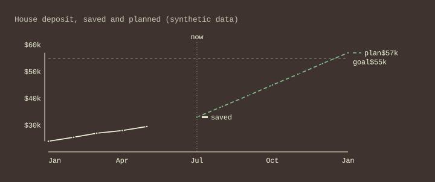
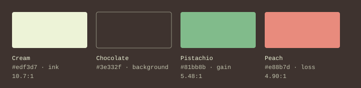
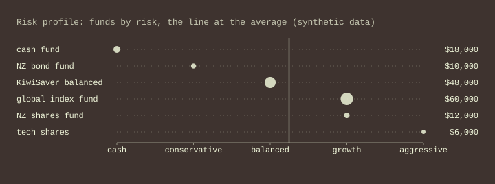
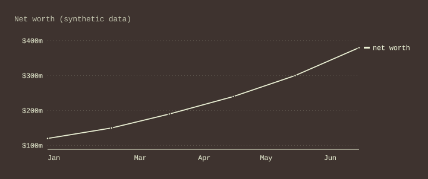
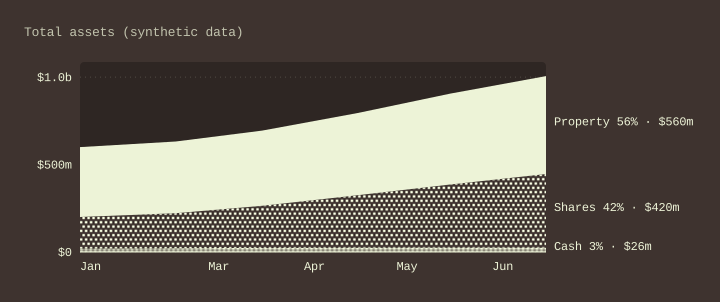
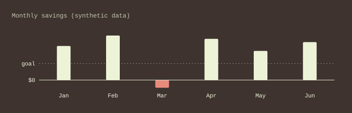
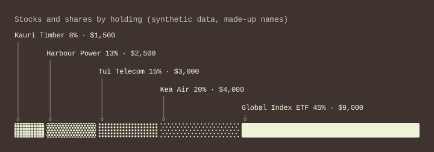
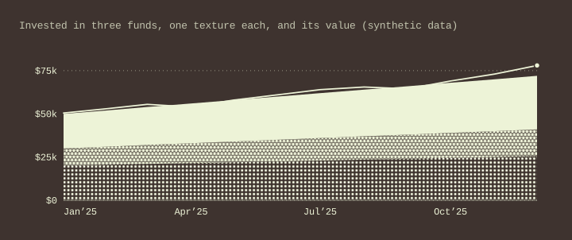
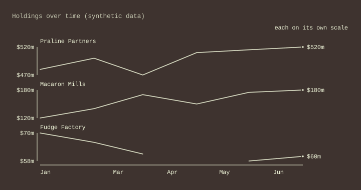

# Sediment

Sediment draws small SVG charts in the browser. It is one JavaScript file with
no dependencies and no build step, and it tells series apart by texture
instead of colour. Each chart describes its data to screen readers, and its
tooltip works from the keyboard.


*Synthetic data in NZD. These are two cards from a personal finance
dashboard, drawn the way it draws them. Each band and segment wears its own
texture and is named on the chart. The largest is solid.*

The style follows Tufte: a dotted hairline grid or a range-frame axis, and
labels placed on the data rather than in a legend. Sediment ships no colours.
You pass every colour in, so it fits any theme.

## A minimal example

```html
<link rel="stylesheet" href="sediment.css">
<script src="sediment.js"></script>

<div id="chart" style="color: #edf3d7; background: #3e332f"></div>

<script>
  const host = document.getElementById("chart");
  const months = ["Jan", "Feb", "Mar", "Apr", "May", "Jun",
                  "Jul", "Aug", "Sep", "Oct", "Nov", "Dec"];
  const xs = Array.from({ length: 13 }, (_, i) => Date.UTC(2026, i, 1));
  const month = t => months[new Date(t).getUTCMonth()];
  const saved = [24000, 25500, 27000, 28000, 29500, null, 33000];
  const plan = [33000, 37000, 41000, 45000, 49000, 53000, 57000];
  const nzd = v => "$" + Math.round(v).toLocaleString("en-NZ");
  const nzdK = v => "$" + Math.round(v / 1000) + "k";

  Sediment.lineChart({
    host, padR: 120, rangeFrame: true,
    title: "House deposit, saved and planned",
    xs,
    series: [
      { values: saved.concat(Array(6).fill(null)), color: "#edf3d7" },
      { values: Array(6).fill(null).concat(plan), color: "#81bb8b", dash: "6 4" },
    ],
    tokens: { axis: "#edf3d7", hair: "rgba(237,243,215,0.5)", page: "#3e332f" },
    fmtK: nzdK, fmtValue: nzd,
    xLabel: month,
    fmtX: t => month(t) + " " + new Date(t).getUTCFullYear(),
    endLabel: i => ["saved", "plan"][i],
    endValue: i => i ? nzdK(plan[6]) : "",
    refs: [{ value: 55000, label: "goal" }],
    events: [{ t: xs[6], label: "now" }],
  });
</script>
```



*Synthetic data.*

The June value is `null`, so the saved line breaks there instead of dropping
to zero. The plan is dashed, so the two lines differ in shape as well as
colour. Each is named at its right end. `rangeFrame` draws the y axis only as
far as the data goes. `title` names the chart for screen readers, and
`fmtValue` and `fmtX` format the numbers and dates in the description
Sediment writes, so it reads "$57,000 (Jan 2027)" rather than "57,000 (Jan)"
(see Accessibility).

## Install

There is no npm package. Copy the two files into your project and load them:

```html
<link rel="stylesheet" href="sediment.css">
<script src="sediment.js"></script>
```

`sediment.js` adds one global, `window.Sediment`. `sediment.css` holds the
companion styles. Only its `svg text` rule is required. Without it, labels
render black at the wrong size. Text colour is inherited, so set `color` on
the chart host and every label follows. The other rules draw the keyboard
focus ring, style the optional data table, and handle forced colours and
reduced motion. Keep them unless you replace them with your own.

To track the repo and pull updates, add it as a git submodule:

```bash
git submodule add https://github.com/jtrotsky/sediment.git vendor/sediment
# later, to update:
git submodule update --remote vendor/sediment
```

Open `demo.html` in a browser to see all seven builders draw from live code.

## Which chart

Pick by the question, not the shape of the data.

| Question | Builder |
| --- | --- |
| What changed? | `lineChart` |
| How has each one moved, when they differ in scale? | `smallMultiples` |
| What is it made of, and how has that changed? | `stackedArea` |
| What is it made of, now? | `segmentedBar` |
| Which is biggest, or how did each month do? | `columnChart` |
| Where does each one sit on a scale? | `dotPlot` |
| How far apart are two measures? | `barLineChart` |

Under about twenty numbers, a table usually beats any of them.

## Accessibility

A Sediment chart is built to read without colour, without a mouse and without
sight. The tests in `test/` check the generated markup and the key handling.
The CSS rules (focus ring, forced colours, reduced motion) have not been seen
in a browser. The last part of this section lists what else is unverified.

### Without colour

- **Texture, not hue.** `stackedArea`, `segmentedBar` and `barLineChart` fill
  each band with a pattern of marks. A band's texture index `ti` picks the
  shape: squares on a rectangular grid for even indexes, circles on a
  hexagonal grid for odd ones. In `stackedArea` and `segmentedBar` the band's
  value sets the spacing. The smallest packs its marks with gaps of 15% of a
  mark, and larger values get wider gaps. The largest band, and
  the last of `n`, is solid. `Sediment.chip()` draws the same pattern as a
  small swatch for a table row.
- **Dashes for lines.** A line series can set `dash`, a stroke-dasharray, so
  two lines differ in shape.
- **Direct labels.** Lines and stacked bands are named at their right ends.
  There is no legend to match against a colour.
- **Honest gaps.** A `null` value in a line leaves a gap. It is never drawn
  as zero.
- **Forced colours.** In Windows high contrast and other forced-colour modes,
  `sediment.css` draws every line, mark and label in the system text colour
  (`CanvasText`) and every background in the system background colour
  (`Canvas`). Series stay apart because they differ by texture and dash.

### Without sight

Every builder marks its `<svg>` as an image with a name and a description.
This is the README example above, as rendered:

```html
<svg viewBox="0 0 672 230" width="100%" height="230" class="sediment"
     role="img" aria-label="House deposit, saved and planned"
     aria-describedby="sediment-1-desc">
  <desc id="sediment-1-desc">Line chart, 2 series: saved, plan. Jan 2026 to
    Jan 2027. saved: latest $33,000 (Jul 2026), low $24,000 (Jan 2026), high
    $33,000 (Jul 2026), no data for 7 points. plan: latest $57,000 (Jan 2027),
    low $33,000 (Jul 2026), high $57,000 (Jan 2027), no data for 6 points.
    Reference line: goal $55,000. Event: now (Jul 2026).</desc>
  ...
```

(Line breaks added. The `<desc>` text is one line.)

- **The name** is `title`. Without one it is the chart kind, such as
  "Line chart".
- **The description** gives the chart kind, the series names, the x range,
  and each series' latest, low and high value with when. It adds reference
  lines, events and missing data. Bar, segment and dot charts list their
  items instead. Pass `desc` as a string to replace it, or as a function to
  edit it: `desc: auto => "The plan reaches the goal in December. " + auto`.
- **Formats.** Values use `fmtValue`, else the builder's own `fmtK` or
  `fmtNZD`. x values use `fmtX`, else `xLabel(t, true)`.
- **No `<title>` element.** Browsers show an SVG's `<title>` as a native hover
  tooltip over the whole chart. It would sit on top of Sediment's own tooltip,
  so the name goes in `aria-label` instead.
- **The numbers as a table.** `table: true` adds a collapsed
  `<details>` after the chart, holding a `<table>` with a caption, one row per
  x value or item, and "no data" for gaps. Pass a string to name its summary
  (default "Data table"). It is off by default because it adds an element
  under the chart and so changes your layout.
- **Texture chips** from `Sediment.chip()` carry `aria-hidden="true"`. They sit
  beside their own words and have nothing to add.
- **`Sediment.describe(svg, { title, desc })`** does the same for an SVG you
  draw yourself with `Sediment.frame()`.

### Without a mouse

A chart with a tooltip (`tip` plus `tipHTML`) also opens it from the keyboard.
Pointer behaviour is unchanged.

| Key | Action |
| --- | --- |
| Tab | Focus the chart (`tabindex="0"`) |
| Right or Down arrow | Next point, column, segment or dot |
| Left or Up arrow | Previous one |
| Home, End | First, last |
| Escape | Close the tooltip |

Time-series charts move the same hairline the pointer moves. Column, segment
and dot charts draw a ring round the active item. A visually hidden
`aria-live="polite"` region reads out the tooltip's text, or the table row
when the tooltip has none. Moving focus away closes the tooltip. The focus
ring is a 2 px outline in the chart's text colour, shown for keyboard focus
only (`:focus-visible`). The description ends with a one-line key guide.

`keyboard: false` turns this off. `keyboard: true` turns it on for a chart
with no tooltip: the keys then move the hairline or ring, and the live
region reads each row.

### Motion

Sediment animates nothing. Under `prefers-reduced-motion: reduce`,
`sediment.css` also turns off any transition or animation a page adds to the
chart or its tooltip.

### What is not done or not verified

- **No assistive technology testing.** Nobody has tried these charts with a
  screen reader (NVDA, JAWS, VoiceOver, TalkBack) or with Windows high
  contrast. The tests check the markup and the key handling in node, against
  a stand-in for the browser DOM, not in a browser.
- **Browse mode may take the arrow keys.** NVDA and JAWS read a page in browse
  mode, where the arrow keys move the reading cursor and never reach the
  chart. A user may need to switch to focus mode. The description and the
  table do not depend on the keys.
- **One stop per x value.** On a chart with several series, each key press
  covers every series at that x, as the tooltip does. There is no way to step
  along one series.
- **English words.** The generated description uses fixed English words
  ("latest", "low", "no data"). Replace it with `desc` for other languages.
- **No contrast checks.** You choose the colours, so you own the contrast. The
  suggested palette below measures 10.7:1 for Cream on Chocolate (WCAG 2
  formula).

## Suggested palette

Sediment ships no colours of its own. If you want a starting point, this is the
warm, high-contrast set the charts in this README were drawn with.



| Colour | Hex | Role | Contrast on Chocolate |
| --- | --- | --- | --- |
| Cream | `#edf3d7` | ink, marks, lines | 10.7:1 |
| Chocolate | `#3e332f` | background | |
| Pistachio | `#81bb8b` | gain | 5.48:1 |
| Peach | `#e88b7d` | loss | 4.90:1 |

Hairlines are Cream at 50% opacity, a tint rather than a separate colour.

## The charts

Each chart below is a card from the same personal finance dashboard, with
synthetic data in NZD. The company names are made up.

### dotPlot
Items on a shared ordinal axis. Position carries the meaning, dot area carries
the amount, and a solid line marks the average. Here each fund sits at its
risk level, and the line marks the average risk, weighted by value.



### lineChart
Lines over a time series, each named at its end. Opt in to a range-frame axis
(`rangeFrame`), latest values (`endValue`), reference lines (`refs`) and events
(`events`). Here net worth is one line, named by its latest value. The
minimal example above uses the opt-ins.



### stackedArea
Stacked bands over time, each band a texture, with each band's share and latest
value labelled on the right. Here grocery spend splits into five groups.
Texture density follows each group's latest value, so only the largest is
solid.



### columnChart
Columns on a shared baseline, positive and negative, with an optional target
line. Here each month's savings meet a $2,000 target. Months that lost money
go below the line in a second colour, and the month still running is faint.



### segmentedBar
Proportional segments, texture-coded, with optional stepped connector labels.
Here each segment is one holding in a share portfolio.



### barLineChart
A textured area for one measure with a line over it for another, so the gap
between them reads at a glance. Here the area is the money put into three
funds, stacked with one texture each, and the line is what they are worth.



### smallMultiples
One panel per series, stacked on one shared time axis. Use it when series
differ in scale, or when the question is each one's shape. Each panel prints its
own min and max. `shared: true` puts every panel on one scale when the question
is level. Here four balances move on very different scales: a mortgage near
$400k beside cash near $20k.



## How it works

Every builder takes resolved values. Colours are CSS colour strings, data is
plain numbers, and text comes from formatter callbacks. The module never reads
your theme, any DOM beyond the host you give it, or any global state. You write
a thin adapter that resolves your theme (for example with `getComputedStyle`)
and feeds these builders. That keeps it portable between projects.

Each builder measures the host's width (at least 320 px), clears the host and
appends a fresh `<svg>`. To redraw, call it again.

## Limits

- **Browser only.** The builders need a DOM. There is no server-side renderer.
- **Time on the x axis is monthly.** The time-series builders take `xs` as
  epoch milliseconds and place ticks on month boundaries. Other units are not
  supported.
- **Money defaults.** `stackedArea` labels values as dollars and title-cases
  band names unless you pass `fmtNZD`. `columnChart` labels its baseline `$0`
  unless you pass `zeroLabel`.
- **Tests, but no CI and no releases.** `node --test test/*.test.js` runs the
  tests with no packages to install (Node 18 or later). They run in node
  against a DOM stand-in, not in a browser. There is no CI and there are no
  version tags.

## Builder reference

Each builder takes one `cfg` object. `host` is the element the SVG mounts into,
sized to the host's width. `tip` is an optional tooltip handle from
`Sediment.tip(el)`.

Every builder also takes these keys (see Accessibility):

```
title,                     // accessible name (default: the chart kind)
desc,                      // string replaces the description, auto => string edits it
fmtValue(v), fmtX(t),      // how values and x values read in words
table=false,               // true or a summary string: a data table after the chart
keyboard,                  // default on with a tooltip; true or false to force
```

**dotPlot**
```
host, rowH=22, padT=8, axisPad=30, rightPad=88,
rows:[{ pos, value, label, valueLabel, tipHTML }],   // pos = 0..(levels-1)
levels:[str],                                        // axis ticks, left to right
avgPos,                                              // optional average line position
staggerLabels,                                       // two-row axis when labels would collide
dotColor, tokens:{ hair, fg }, tip
```

**lineChart**
```
host, H=230, padL=56, padR=92, padT=14, padB=26,
xs:[t], series:[{ values:[v], color, dash, label }], // null value = gap; label names it in words
tokens:{ axis, hair, page, ref },
fmtK, fmtTick(v, top), rangeFrame=false, xLabel, endLabel, endValue,
refs:[{ value, label, showValue }], events:[{ t, label }],
annotateExtremes, extremeLabel(v, t, kind), tip, tipHTML
```

The y axis is the dotted grid unless `rangeFrame` is set, which draws a range
frame instead. `fmtTick` formats the y ticks and is told which is the top one.
With a range frame the unit can go there once. On the grid every tick counts as
the top one. Lines are solid unless a series sets `dash`. Extremes are labelled
with `fmtK` unless `extremeLabel` is given. Events add 8 px to the top padding
for their labels.

**stackedArea**
```
host, H=230, padL=56, padR=110, padT=14, padB=26,
xs:[t], bands:[{ values:[v], ti, label }], n,        // ti = texture index
ink, bg, tokens:{ surface, axis, hair, ref },
fmtK, fmtTick, fmtNZD, rangeFrame=false, xLabel, refs, events, tip, tipHTML
```

`fmtNZD` formats the value in each band's end label. Without it the label reads
`$` and the rounded value.

**columnChart**
```
host, H=160, padL=56, padR=12, padT=14, padB=26,
bars:[{ value, label, faint }],
posColor, negColor, ink, tokens:{ border },
target, targetLabel, zeroLabel="$0", tip, tipHTML
```

**segmentedBar**
```
host, barH=24, gap=4, minSeg=24,
segments:[{ label, value, ti, tipHTML }], n, total,
ink, tokens:{ border, hair },
connectors=false, step=30, topPad=14, labelGap=8, tip
```

**barLineChart**
```
host, H=230, padL=56, padR=20, padT=14, padB=26,
xs:[t], bars:[v], line:[v], ti, ink,
areaLabel="area", lineLabel="line",                  // their names in words
tokens:{ axis, hair, page, ref }, fmtK, fmtTick, rangeFrame=false, xLabel, refs,
events, tip, tipHTML
```

**smallMultiples**
```
host, panelH=56, gap=30, padL=56, padR=92, padB=26,
xs:[t], panels:[{ label, values:[v], color, refs }], shared=false, note,
tokens:{ axis, hair, page, ref }, fmtK, xLabel, tip, tipHTML
```

## Helpers

- `Sediment.tip(el)` returns `{ show(host, x, y, html), hide }`, a floating
  tooltip bound to `el`. Style it with the `.sediment-tip` rules in
  `sediment.css`.
- `Sediment.texture(svg, i, n, ink)` is the pattern fill for band `i` of `n`
  (the last band is solid). `Sediment.chip(i, n, ink, size)` returns an
  inline-SVG swatch of that texture for legends and tables.
- `Sediment.describe(svg, { title, desc })` gives an SVG `role="img"`, an
  `aria-label` and a `<desc>`. Every builder calls it. Call it yourself on an
  SVG you build with `frame()`.
- `Sediment.valueRanks(values)` ranks each value from 0 (smallest) to 1
  (largest), so texture density can follow magnitude.
- `Sediment.svgEl`, `frame`, `yScale`, `niceTicks`, `axisTicks`, `rangeFrame`,
  `grid`, `monthTicks`, `placedMonthTicks` are the low-level building blocks.

## Licence

MIT. See [LICENSE](LICENSE).
